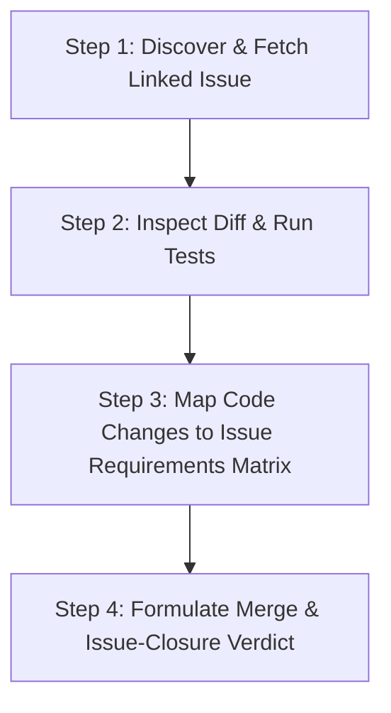

# PR & Issue Verifier Skill (`pr-issue-verifier`)

This skill ensures that whenever a teammate or contributor submits a Pull Request (PR) or feature branch to be validated before merging, the agent **always checks the original GitHub issue's requirements, implementation steps, and acceptance criteria first**.

It prevents premature issue closures, distinguishes between complete solutions and safe incremental progress, and guarantees the team knows exactly what remains to be done.

---

## 1. Trigger Conditions

Activate this skill whenever the user asks:
- "Check this PR and validate if it's good to go"
- "Check if the PR is good to merge"
- "Is this issue resolved / good before merging?"
- "Verify PR against issue requirements"
- "Check if my teammate's PR covers everything"
- Any variation of PR validation, merge verification, or issue completion checking.

---

## 2. Core Verification Workflow (4 Steps)



### Step 1: Discover & Fetch Linked Issue
1. **Identify the Issue Number**:
   - Extract from PR title (e.g., `#28`, `Fix/issue 8`), branch name, commit message, or PR body.
   - If not obvious, list open issues (`gh issue list --state open`) or ask the user.
2. **Fetch Full Issue Details**:
   - Run `gh issue view <issue_number>` (using `BypassSandbox: true` if network access is restricted).
   - Extract three critical elements:
     - **Problem Statement**: What bug or need sparked this issue?
     - **Prescribed Steps**: Did the issue author outline sequential steps (e.g., Step 1, Step 2, Step 3...)?
     - **Acceptance Criteria ("Done When")**: Specific checklist items that must pass before the issue can be closed.

### Step 2: Inspect Diff & Run Tests
1. **Inspect Changed Files & Unified Diff**:
   - Run `git diff main...HEAD` or `gh pr diff <pr_number>`.
   - Identify every modified, created, or deleted file.
2. **Verify Test Suite**:
   - Run `pytest` across the test suite.
   - Confirm all existing tests pass and any new tests required by the issue exist and pass.

### Step 3: Map Code Changes to Issue Requirements Matrix
Build a concrete **Acceptance Criteria Matrix** comparing the issue's requirements directly against the actual code changes:

| Requirement / Step | Status | Evidence in Code / Test | Impact on Merge / Issue |
| :--- | :--- | :--- | :--- |
| **Step 1: ...** | `COMPLETE` / `PARTIAL` / `NOT STARTED` | `file.py:L10-L20` | Resolves core problem. |
| **Step 2: ...** | `COMPLETE` / `PARTIAL` / `NOT STARTED` | ... | ... |
| **Done When: ...** | `MET` / `UNMET` | `tests/test_x.py` | Required for issue close. |

### Step 4: Formulate Merge & Issue-Closure Verdict

Always provide a dual verdict:
1. **PR Merge Decision**:
   - **`READY TO MERGE`**: Code is clean, tests pass, no regressions, and changes make positive progress.
   - **`DO NOT MERGE / CHANGES REQUESTED`**: Tests fail, regression introduced, or critical security/correctness bug present.
2. **GitHub Issue Closure Decision**:
   - **`FULL RESOLUTION - CLOSE ISSUE`**: 100% of issue steps and acceptance criteria are satisfied. Issue can be closed on merge.
   - **`PARTIAL RESOLUTION - KEEP ISSUE OPEN`**: The PR is safe to merge as an incremental step, but specific remaining steps from the issue are still open. **Explicitly list what remains for the next PR.**

---

## 3. Standard Verification Output Template

When reporting findings back to the user, follow this structured format:

```markdown
# PR & Issue Verification Report: PR #[Number] -> Issue #[Number]

## 1. Executive Summary & Dual Verdict
- **PR Merge Recommendation:** [READY TO MERGE / CHANGES REQUESTED]
- **Issue Closure Status:** [FULL RESOLUTION (Close Issue) / PARTIAL RESOLUTION (Keep Issue Open)]
- **Test Suite Status:** [e.g., 114 passed, 0 failed]
- **Key Takeaway:** [1-2 sentences summarizing the state of the PR and issue]

## 2. Requirements & Acceptance Criteria Matrix

| Issue Requirement / Step | Status | Code Evidence | Notes |
| :--- | :--- | :--- | :--- |
| [Step 1 from Issue] | COMPLETE | [`infra/file.py`](...) | Fully addressed |
| [Step 2 from Issue] | PARTIAL / UNMET | - | [Explain what remains] |
| [Acceptance Criteria 1] | MET | [`tests/test_x.py`](...) | Tests verified passing |

## 3. What This PR Accomplishes (Merged Scope)
- [Bullet points of concrete improvements merged]

## 4. Remaining Scope (If Issue Stays Open)
- [Explicit bullet points of what teammate or next PR needs to complete to close the issue]

## 5. Recommended Action
- [Exact git commands or GitHub instructions for the user]
```

