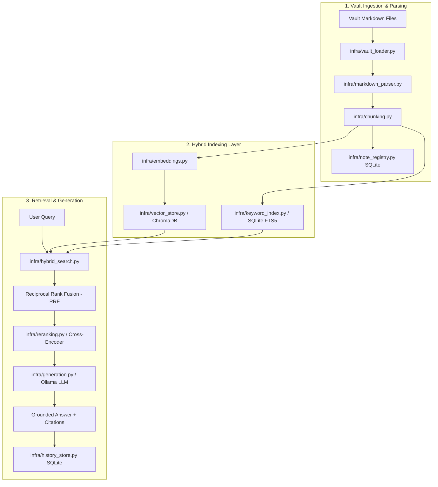

# obsidian-rag Architectural File Definitions & Directory Map

This document catalogs every source file, configuration template, entrypoint, and database in `obsidian-rag`.

---

## 1. System Pipeline Overview

---

## 2. Directory & Component Catalog

### Root Files
- **`.env.example` / `.env`**: Environment template and local configuration settings.
- **`.gitignore`**: Excludes `.env`, `data/`, and database files to prevent data leakage.
- **`fastapi.bat`**: Windows batch launcher for the FastAPI backend (`uvicorn infra.main:app`).
- **`run.bat`**: Windows batch launcher for the Streamlit dashboard (`streamlit run streamlit_app.py`).
- **`streamlit_app.py`**: Streamlit interactive frontend for querying and vault navigation.
- **`README.md`**: Project overview, architecture diagrams, quickstart, and benchmarking guide.

### `core/` (Architectural Context)
- **`core/dependencies.txt`**: Minimal requirements listing core python dependencies.
- **`core/PROJECT-CONTEXT.md`**: High-level problem statement, domain boundaries, and solution design.
- **`core/MUST-HAVES.md`**: Core non-negotiable requirements for search, grounding, and security.
- **`core/FILE-DEFINITIONS.md`**: This document.

### `infra/` (Pipeline Implementation)
- **`infra/config.py`**: Immutable dataclass `Settings` loading runtime environment variables.
- **`infra/auth.py`**: Constant-time `X-API-Key` verification dependency.
- **`infra/sqlite_utils.py`**: Context manager for transactional, auto-closing SQLite connections.
- **`infra/vault_loader.py`**: Filesystem scanner discovering `.md` files while skipping hidden/system directories.
- **`infra/markdown_parser.py`**: Extracts YAML frontmatter, inline `#tags`, code fence masking, and `[[wikilinks]]`.
- **`infra/chunking.py`**: Heading-aware sliding window chunking with contextual breadcrumb headers.
- **`infra/note_registry.py`**: SQLite database storing note metadata, tags, and graph connections.
- **`infra/embeddings.py`**: Ollama HTTP client for generating dense embeddings (with task prefixes).
- **`infra/vector_store.py`**: ChromaDB persistent client wrapper managing collection vectors.
- **`infra/keyword_index.py`**: SQLite FTS5 sparse text index with BM25 ranking and query sanitization.
- **`infra/reranking.py`**: `BAAI/bge-reranker-base` cross-encoder scoring with fallback support.
- **`infra/hybrid_search.py`**: Reciprocal Rank Fusion (RRF) combining BM25 and vector hits.
- **`infra/indexing.py`**: VaultIndexer managing incremental SHA-256 vault synchronization.
- **`infra/generation.py`**: Grounded answer generator with prompt-injection defense and citation mapping.
- **`infra/history_store.py`**: SQLite search history logger with distinct query deduplication.
- **`infra/main.py`**: FastAPI application exposing `/`, `/index`, `/search`, `/ask`, `/notes/{id}/related`, and `/history`.

### `sample_vault/` (Curated Demo Vault)
Contains 8 realistic, interlinked markdown notes exercising the full feature spectrum without personal data.

